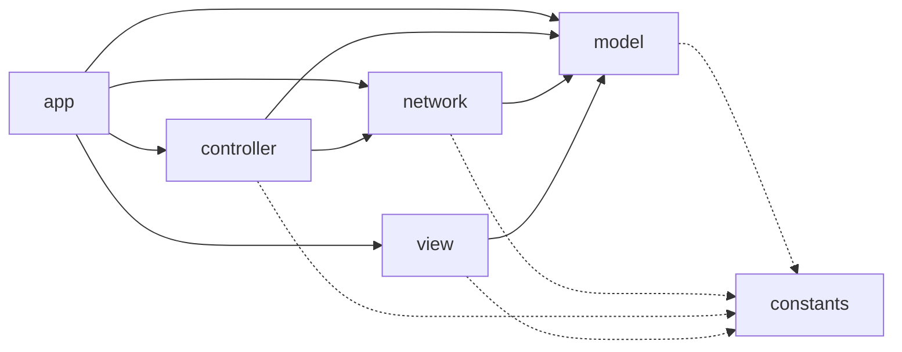
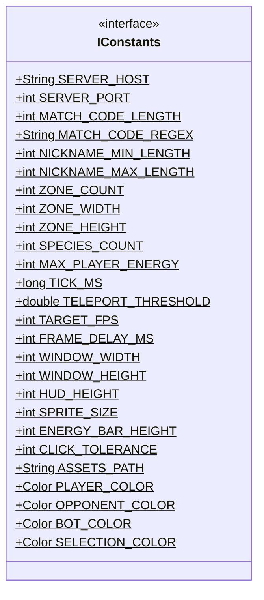
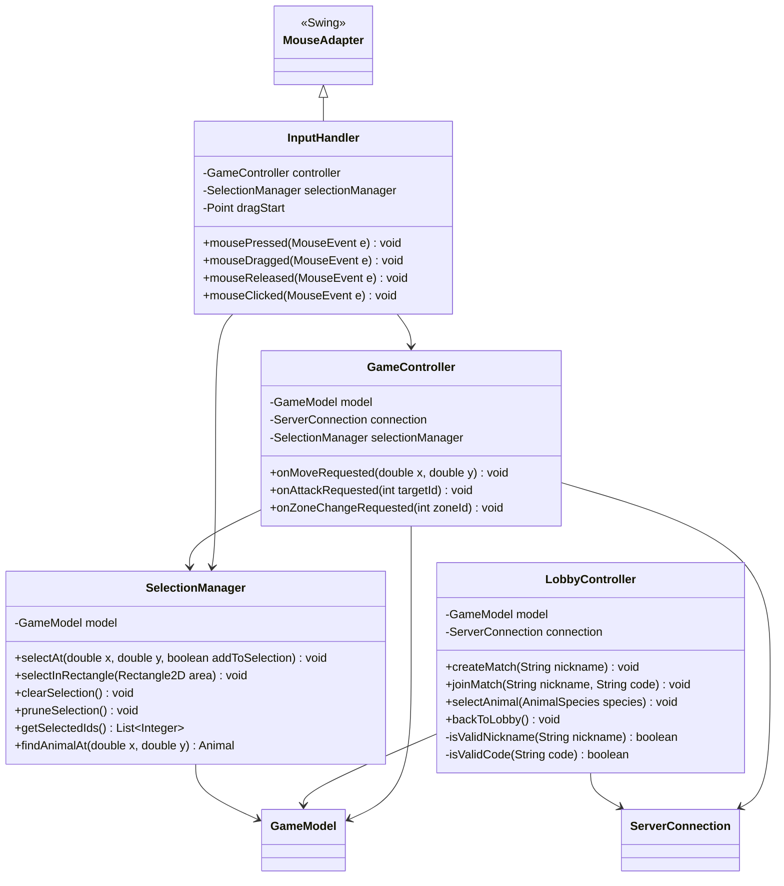
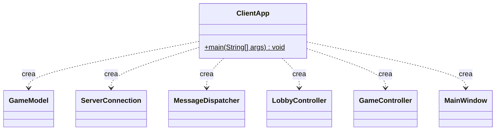

# Jungle Attack - Cliente

## Integrantes

* Andy Quiros Salazar
* Jordan Seas Alvarez

## Specs

> El contrato JSON completo (mensajes, campos y códigos de error) está en el README del servidor, sección \*\*Package: protocol\*\*. Los records de `model.dto.Payloads` del cliente son una copia exacta de los del servidor.

### Vista general de paquetes



> `model` no depende de `network`: los DTO que llegan del servidor viven en `model.dto`, así los handlers de red los convierten y el modelo los aplica sin conocer el socket.

### Validaciones del lado del cliente

Para no cargar todo al servidor, el cliente no envía mensajes que se sabe que van a fallar. El servidor vuelve a validar todo, porque es la autoridad.

|Acción|Validación local|Dónde|
|-|-|-|
|Crear / unirse|Apodo entre 3 y 16 caracteres; código con `MATCH\_CODE\_REGEX`|LobbyController|
|Elegir especie|Solo especies disponibles (botón deshabilitado si ya la tomó el rival)|AnimalSelectionPanel|
|Mover|Hay animales seleccionados y el clic cae sobre un camino de la imagen de la zona (`jungla\_\*.svg`, con su ancho real)|GameController + TerrainTile|
|Atacar|Hay animales seleccionados y el objetivo no es propio|GameController|
|Cambiar zona|Solo zonas visibles (botones deshabilitados)|GameController + HudPanel|
|Animación|Interpolación entre snapshots a 30 FPS sin pedir nada al servidor|GamePanel|

### Package: constants



```java
public interface IConstants

+static final String SERVER\_HOST = "localhost" // host del servidor
+static final int SERVER\_PORT = 5050 // igual que el servidor
+static final int MATCH\_CODE\_LENGTH = 4 // largo del código de partida
+static final String MATCH\_CODE\_REGEX = "\[A-Za-z0-9]{4}" // validación local del código
+static final int NICKNAME\_MIN\_LENGTH = 3 // igual que el servidor
+static final int NICKNAME\_MAX\_LENGTH = 16 // igual que el servidor
+static final int ZONE\_COUNT = 12 // zonas del mapa
+static final int ZONE\_WIDTH = 800 // ancho de una zona en unidades del servidor
+static final int ZONE\_HEIGHT = 600 // alto de una zona en unidades del servidor
+static final int SPECIES\_COUNT = 7 // especies disponibles
+static final int MAX\_PLAYER\_ENERGY = 20 // energía máxima de un animal del jugador
+static final long TICK\_MS = 100 // cada cuánto llega un STATE\_UPDATE (para interpolar)
+static final double TELEPORT\_THRESHOLD = 200 // salto mayor a esto no se interpola (cambio de zona)
+static final int TARGET\_FPS = 30 // cuadros por segundo del render
+static final int FRAME\_DELAY\_MS = 1000 / TARGET\_FPS // delay del Timer de Swing
+static final int WINDOW\_WIDTH = 1024 // ancho de la ventana
+static final int WINDOW\_HEIGHT = 768 // alto de la ventana
+static final int HUD\_HEIGHT = 60 // alto de la barra superior del juego
+static final int SPRITE\_SIZE = 32 // tamaño de un animal en pantalla
+static final int ENERGY\_BAR\_HEIGHT = 4 // alto de la barra de energía
+static final int CLICK\_TOLERANCE = 20 // radio en píxeles para detectar un clic sobre un animal o un camino
+static final String ASSETS\_PATH = "/assets/svg/" // carpeta de los SVG
+static final Color PLAYER\_COLOR = new Color(46, 160, 67) // verde
+static final Color OPPONENT\_COLOR = new Color(214, 48, 49) // rojo
+static final Color BOT\_COLOR = new Color(120, 120, 120) // gris
+static final Color SELECTION\_COLOR = new Color(255, 214, 0) // amarillo
```

### Package: model

**Clase principal testeable:** `GameModel`

```mermaid
classDiagram
    class AnimalSpecies {
        <<enumeration>>
        JAGUAR
        SLOTH
        SCARLET\_MACAW
        WHITE\_FACED\_MONKEY
        TOUCAN
        RED\_EYED\_TREE\_FROG
        COATI
        -String displayName
        -String svgFile
        +getDisplayName() String
        +getSvgFile() String
        +fromName(String name)$ AnimalSpecies
    }
    class PackType {
        <<enumeration>>
        PLAYER
        OPPONENT
        BOT
    }
    class GamePhase {
        <<enumeration>>
        LOBBY
        WAITING\_OPPONENT
        SELECTING\_ANIMAL
        PLAYING
        GAME\_OVER
    }
    class EventType {
        <<enumeration>>
        ATTACK
        ANIMAL\_DIED
        CUP\_COLLECTED
        BOT\_KILLED
    }
    class ModelChange {
        <<enumeration>>
        PHASE\_CHANGED
        SPECIES\_UPDATED
        STATE\_UPDATED
        ZONE\_CHANGED
        SELECTION\_CHANGED
        ERROR
    }
    class Entity {
        <<abstract>>
        #int id
        #double x
        #double y
        +getId() int
        +getX() double
        +getY() double
        +setPosition(double x, double y) void
        +getSvgName()\* String
    }
    class Animal {
        -AnimalSpecies species
        -int packId
        -PackType packType
        -int energy
        -boolean alive
        -boolean selected
        -double prevX
        -double prevY
        +getRenderX(double alpha) double
        +getRenderY(double alpha) double
        +applyState(int energy, double x, double y, boolean alive) void
        +isAlive() boolean
        +isOwn() boolean
        +isSelected() boolean
        +setSelected(boolean selected) void
        +getSpecies() AnimalSpecies
        +getPackId() int
        +getPackType() PackType
        +getEnergy() int
        +getSvgName() String
    }
    class CoffeeCup {
        +CoffeeCup(int id, double x, double y)
        +getSvgName() String
    }
    class Flag {
        -PackType owner
        +Flag(int id, PackType owner, double x, double y)
        +getSvgName() String
    }
    class Pack {
        -int id
        -AnimalSpecies species
        -PackType type
        -int damageCapacity
        -List\~Animal\~ members
        +getLivingMembers() List\~Animal\~
        +countAlive() int
    }
    class Zone {
        -int id
        -List\~Integer\~ neighborIds
        -List\~PathSegment\~ paths
        -boolean visible
        -List\~Entity\~ entities
        +isVisible() boolean
        +getEntities() List\~Entity\~
        +isOnPath(double x, double y, double tolerance) boolean
    }
    class PathSegment {
        -double x1, y1
        -double x2, y2
        +contains(double x, double y, double tolerance) boolean
    }
    class MatchSummary {
        -String winnerNickname
        -String reason
        -int botsEliminated
        -Map\~Integer,Integer\~ animalsEliminatedByPack
        -int playerCups
        -int opponentCups
        -long durationMs
    }
    class GameEvent {
        -EventType type
        -int sourceId
        -int targetId
        +getType() EventType
    }
    class Payloads {
        <<final>>
    }
    note for Payloads "model.dto: copia exacta de los records del servidor"
    class IGameObserver {
        <<interface>>
        +onModelChanged(ModelChange change) void
    }
    class GameModel {
        -GamePhase phase
        -String nickname
        -String opponentNickname
        -String matchCode
        -AnimalSpecies species
        -List\~AnimalSpecies\~ availableSpecies
        -AnimalSpecies opponentChoice
        -int currentZoneId
        -Map\~Integer,Zone\~ zones
        -List\~Pack\~ packs
        -List\~Animal\~ selectedAnimals
        -int damageCapacity
        -int botsKilled
        -int cupsConsumed
        -List\~GameEvent\~ lastEvents
        -String lastError
        -long lastSnapshotNanos
        -MatchSummary summary
        -List\~IGameObserver\~ observers
        +addObserver(IGameObserver o) void
        +removeObserver(IGameObserver o) void
        -notifyObservers(ModelChange change) void
        +applyGameStarted(GameStarted data) void
        +applySnapshot(StateUpdate snapshot, long nowNanos) void
        +applySummary(Summary data) void
        +setAvailableSpecies(List\~AnimalSpecies\~ available, AnimalSpecies opponentChoice) void
        +setPhase(GamePhase phase) void
        +setCurrentZone(int zoneId) void
        +isZoneVisible(int zoneId) boolean
        +getCurrentZone() Zone
        +getSelectedAnimals() List\~Animal\~
        +getLastEvents() List\~GameEvent\~
        +getInterpolationAlpha(long nowNanos) double
        +setError(String message) void
        +reset() void
    }
    note for GameModel "Subject del patrón Observer"

    Entity <|-- Animal
    Entity <|-- CoffeeCup
    Entity <|-- Flag
    Animal --> AnimalSpecies
    Animal --> PackType
    Flag --> PackType
    Pack --> AnimalSpecies
    Pack --> PackType
    Pack "1" \*-- "many" Animal : members
    Zone "1" \*-- "many" PathSegment : paths
    Zone "1" o-- "many" Entity : entities
    GameEvent --> EventType
    GameModel --> GamePhase
    GameModel "1" \*-- "12" Zone : zones
    GameModel "1" o-- "many" Pack : packs
    GameModel --> MatchSummary
    GameModel "1" o-- "many" IGameObserver : observers
    GameModel ..> Payloads : aplica
    IGameObserver ..> ModelChange
```

```java
enum AnimalSpecies  // mismos nombres que el servidor, para que fromName funcione con el JSON
JAGUAR("Jaguar", "jaguar.svg")
SLOTH("Perezoso", "sloth.svg")
SCARLET\_MACAW("Lapa roja", "scarlet\_macaw.svg")
WHITE\_FACED\_MONKEY("Mono cariblanco", "white\_faced\_monkey.svg")
TOUCAN("Tucán", "toucan.svg")
RED\_EYED\_TREE\_FROG("Rana calzonuda", "red\_eyed\_tree\_frog.svg")
COATI("Pizote", "coati.svg")
-String displayName // nombre para mostrar
-String svgFile // nombre del archivo SVG del animal
+String getDisplayName()
+String getSvgFile()
+static AnimalSpecies fromName(String name) // convierte el texto del JSON a la especie

enum PackType
PLAYER, OPPONENT, BOT // quién controla el pack, define el color y las acciones permitidas

enum GamePhase
LOBBY, WAITING\_OPPONENT, SELECTING\_ANIMAL, PLAYING, GAME\_OVER // fase actual del cliente

enum ModelChange
PHASE\_CHANGED, SPECIES\_UPDATED, STATE\_UPDATED, ZONE\_CHANGED, SELECTION\_CHANGED, ERROR // qué cambió en el modelo

abstract class Entity
#int id // id asignado por el servidor
#double x // coordenada horizontal local a la zona (0 a ZONE\_WIDTH)
#double y // coordenada vertical local a la zona (0 a ZONE\_HEIGHT)
#Entity(int id, double x, double y) // toda entidad viene del servidor con id y posición
+int getId()
+double getX()
+double getY()
+void setPosition(double x, double y)
+abstract String getSvgName() // cada entidad dice qué imagen usa (polimorfismo)

class Animal extends Entity
-AnimalSpecies species // especie
-int packId // pack al que pertenece
-PackType packType // PLAYER, OPPONENT o BOT
-int energy // energía actual
-boolean alive // está vivo
-boolean selected // seleccionado por el jugador (solo local)
-double prevX // posición del snapshot anterior (para interpolar)
-double prevY
+double getRenderX(double alpha) // prevX + (x - prevX) \* alpha
+double getRenderY(double alpha)
+void applyState(int energy, double x, double y, boolean alive) // guarda la posición actual en prev y aplica la nueva
+boolean isAlive()
+boolean isOwn() // packType == PLAYER
+boolean isSelected()
+void setSelected(boolean selected) // ignora la selección si el animal está muerto
+AnimalSpecies getSpecies()
+int getPackId()
+PackType getPackType()
+int getEnergy()
+String getSvgName() // sobrescribe: devuelve el SVG de su especie

class CoffeeCup extends Entity
+CoffeeCup(int id, double x, double y)
+String getSvgName() // sobrescribe: devuelve el SVG de la taza de café

class Flag extends Entity
-PackType owner // de quién es la bandera
+Flag(int id, PackType owner, double x, double y)
+String getSvgName() // sobrescribe: devuelve el SVG de la bandera

class Pack
-int id // id del pack
-AnimalSpecies species // especie del pack
-PackType type // PLAYER, OPPONENT o BOT
-int damageCapacity // daño compartido por todos los miembros
-List<Animal> members // animales del pack
+List<Animal> getLivingMembers() // solo los vivos
+int countAlive()

class Zone
-int id // 0 a 11
-List<Integer> neighborIds // zonas conectadas por camino
-List<PathSegment> paths // caminos transitables dentro de la zona (vienen en GAME\_STARTED)
-boolean visible // true si el jugador tiene un animal vivo ahí
-List<Entity> entities // lo visible en la zona (animales, tazas, bandera)
+boolean isVisible()
+List<Entity> getEntities()
+boolean isOnPath(double x, double y, double tolerance) // algún PathSegment contiene el punto

class PathSegment
-double x1, y1 // punto inicial
-double x2, y2 // punto final
+boolean contains(double x, double y, double tolerance) // distancia del punto al segmento ≤ tolerance (valida clics de destino)

class MatchSummary
-String winnerNickname // ganador (null si hay empate)
-String reason // FLAG\_TOUCHED, ALL\_DEAD u OPPONENT\_LEFT
-int botsEliminated // bots eliminados
-Map<Integer, Integer> animalsEliminatedByPack // bajas por pack
-int playerCups // tazas consumidas por el jugador
-int opponentCups // tazas consumidas por el oponente
-long durationMs // duración del match

class GameEvent
-EventType type // ATTACK, ANIMAL\_DIED, CUP\_COLLECTED, BOT\_KILLED
-int sourceId // quién genera el evento
-int targetId // a quién afecta
+EventType getType() // sirve para disparar animaciones y sonidos

final class model.dto.Payloads
// Copia exacta de los records del servidor (ver README del servidor, Package: protocol):
// AnimalState, CupState, FlagState, EventState, ZoneInfo, StateUpdate, GameStarted, Summary

interface IGameObserver
+void onModelChanged(ModelChange change) // se llama cada vez que el sujeto notifica un cambio

class GameModel  (Subject del Observer)
-GamePhase phase // fase actual
-String nickname // apodo del jugador
-String opponentNickname // apodo del rival
-String matchCode // código de la partida
-AnimalSpecies species // especie propia
-List<AnimalSpecies> availableSpecies // especies que aún se pueden elegir
-AnimalSpecies opponentChoice // especie del rival (null si no ha elegido)
-int currentZoneId // zona que se está viendo
-Map<Integer, Zone> zones // las 12 zonas
-List<Pack> packs // packs conocidos
-List<Animal> selectedAnimals // selección actual del jugador
-int damageCapacity // daño actual del pack propio
-int botsKilled // contador de bots eliminados
-int cupsConsumed // tazas consumidas
-List<GameEvent> lastEvents // eventos del último snapshot
-String lastError // último mensaje de error del servidor
-long lastSnapshotNanos // cuándo llegó el último STATE\_UPDATE (System.nanoTime)
-MatchSummary summary // resumen al terminar
-List<IGameObserver> observers // vistas suscritas
+void addObserver(IGameObserver o)
+void removeObserver(IGameObserver o)
-void notifyObservers(ModelChange change) // avisa a todas las vistas
+void applyGameStarted(Payloads.GameStarted data) // arma las 12 zonas, guarda el rival y aplica el estado inicial; pasa a PLAYING
+void applySnapshot(Payloads.StateUpdate snapshot, long nowNanos) // actualiza la zona actual, zonas visibles, contadores y eventos → STATE\_UPDATED
+void applySummary(Payloads.Summary data) // guarda el MatchSummary y pasa a GAME\_OVER
+void setAvailableSpecies(List<AnimalSpecies> available, AnimalSpecies opponentChoice) // → SPECIES\_UPDATED
+void setPhase(GamePhase phase) // → PHASE\_CHANGED
+void setCurrentZone(int zoneId) // solo permite zonas visibles → ZONE\_CHANGED
+boolean isZoneVisible(int zoneId)
+Zone getCurrentZone()
+List<Animal> getSelectedAnimals()
+List<GameEvent> getLastEvents()
+double getInterpolationAlpha(long nowNanos) // min(1, (nowNanos - lastSnapshotNanos) / (TICK\_MS \* 1\_000\_000))
+void setError(String message) // → ERROR
+void reset() // limpia todo para volver al lobby
```

### Package: network

**Clase principal testeable:** `MessageSerializer`

```mermaid
classDiagram
    class MessageType {
        <<enumeration>>
        CREATE\_MATCH
        JOIN\_MATCH
        SELECT\_ANIMAL
        MOVE\_ANIMALS
        ATTACK
        VIEW\_ZONE
        MATCH\_CREATED
        MATCH\_JOINED
        ERROR
        ANIMAL\_SELECTION
        GAME\_STARTED
        STATE\_UPDATE
        GAME\_OVER
    }
    class Message {
        -MessageType type
        -JsonObject payload
        +getType() MessageType
        +getPayload() JsonObject
        +create(MessageType type, Map\~String,Object\~ fields)$ Message
    }
    class MessageSerializer {
        -Gson GSON$
        +toJson(Message message)$ String
        +fromJson(String line)$ Message
        +payloadAs(Message m, Class\~T\~ type)$ T
    }
    class ServerConnection {
        <<Singleton>>
        -Socket socket
        -BufferedReader reader
        -PrintWriter writer
        -MessageReceiver receiver
        -ServerConnection()
        +getInstance()$ ServerConnection
        +connect(MessageDispatcher dispatcher) void
        +send(Message message) void
        +close() void
    }
    note for ServerConnection "Holder idiom. send() es synchronized"
    class Runnable {
        <<interface>>
        +run() void
    }
    class MessageReceiver {
        -BufferedReader reader
        -MessageDispatcher dispatcher
        -boolean running
        +run() void
        +stop() void
    }
    class IMessageHandler {
        <<interface>>
        +handle(Message message) void
    }
    class MessageDispatcher {
        -Map\~MessageType,IMessageHandler\~ handlers
        -GameModel model
        +register(MessageType type, IMessageHandler handler) void
        +dispatch(Message message) void
    }
    note for MessageDispatcher "Strategy. Ejecuta con SwingUtilities.invokeLater"
    class MatchCreatedHandler
    class MatchJoinedHandler
    class AnimalSelectionHandler
    class GameStartedHandler
    class StateUpdateHandler
    class GameOverHandler
    class ErrorHandler

    Message --> MessageType
    MessageSerializer ..> Message
    MessageSerializer ..> Payloads : payloadAs
    ServerConnection \*-- MessageReceiver
    ServerConnection ..> Message : send
    Runnable <|.. MessageReceiver
    MessageReceiver --> MessageDispatcher
    MessageDispatcher "1" o-- "many" IMessageHandler : handlers
    MessageDispatcher --> GameModel
    IMessageHandler <|.. MatchCreatedHandler
    IMessageHandler <|.. MatchJoinedHandler
    IMessageHandler <|.. AnimalSelectionHandler
    IMessageHandler <|.. GameStartedHandler
    IMessageHandler <|.. StateUpdateHandler
    IMessageHandler <|.. GameOverHandler
    IMessageHandler <|.. ErrorHandler
```

```java
enum MessageType
CREATE\_MATCH, JOIN\_MATCH, SELECT\_ANIMAL, MOVE\_ANIMALS, ATTACK, VIEW\_ZONE // cliente  -> servidor
MATCH\_CREATED, MATCH\_JOINED, ERROR, ANIMAL\_SELECTION, GAME\_STARTED, STATE\_UPDATE, GAME\_OVER // servidor -> cliente

class Message
-MessageType type // tipo del mensaje
-JsonObject payload // contenido
+MessageType getType()
+JsonObject getPayload()
+static Message create(MessageType type, Map<String, Object> fields) // arma un mensaje a partir de un tipo y sus campos

class MessageSerializer
-static final Gson GSON // instancia única de Gson
+static String toJson(Message message) // objeto → una línea JSON
+static Message fromJson(String line) // una línea JSON → objeto
+static <T> T payloadAs(Message m, Class<T> type) // convierte el payload a un record de model.dto.Payloads

class ServerConnection  (Singleton, holder idiom)
-static class Holder // clase interna que guarda INSTANCE
-Socket socket
-BufferedReader reader // UTF-8
-PrintWriter writer // UTF-8
-MessageReceiver receiver // hilo lector
-ServerConnection() // constructor privado
+static ServerConnection getInstance()
+void connect(MessageDispatcher dispatcher) // abre el socket e inicia el hilo lector
+synchronized void send(Message message) // envía un mensaje (sincronizado, lo llaman varios controladores)
+void close() // cierra socket y flujos en finally

class MessageReceiver implements Runnable
-BufferedReader reader
-MessageDispatcher dispatcher
-volatile boolean running
+void run() // lee línea por línea, fromJson y delega al dispatcher; si se pierde la conexión → model.setError(...)
+void stop()

interface IMessageHandler
+void handle(Message message) // cada tipo de mensaje del servidor tiene su manejador

class MessageDispatcher
-Map<MessageType, IMessageHandler> handlers // tipo → manejador (Strategy)
-GameModel model
+void register(MessageType type, IMessageHandler handler)
+void dispatch(Message message) // busca el manejador y lo ejecuta con SwingUtilities.invokeLater

// Manejadores (todos implements IMessageHandler, reciben el GameModel en el constructor)
class MatchCreatedHandler // guarda el código y pasa a WAITING\_OPPONENT
class MatchJoinedHandler // guarda el apodo del rival y pasa a SELECTING\_ANIMAL
class AnimalSelectionHandler // model.setAvailableSpecies(available, opponentChoice)
class GameStartedHandler // model.applyGameStarted(payloadAs(m, Payloads.GameStarted.class))
class StateUpdateHandler // model.applySnapshot(payloadAs(m, Payloads.StateUpdate.class), System.nanoTime())
class GameOverHandler // model.applySummary(payloadAs(m, Payloads.Summary.class))
class ErrorHandler // model.setError(message): código inválido, partida llena, especie ya tomada, etc.
```

### Package: controller

**Clase principal testeable:** `SelectionManager`



```java
class SelectionManager
-GameModel model
+void selectAt(double x, double y, boolean addToSelection) // clic simple sobre un animal propio (con Shift agrega a la selección)
+void selectInRectangle(Rectangle2D area) // selección por arrastre, solo animales propios y vivos
+void clearSelection()
+void pruneSelection() // quita de la selección los muertos o los que ya no están en la zona actual (se llama en cada STATE\_UPDATE)
+List<Integer> getSelectedIds()
+Animal findAnimalAt(double x, double y) // usa CLICK\_TOLERANCE

class GameController
-GameModel model
-ServerConnection connection
-SelectionManager selectionManager
+void onMoveRequested(double x, double y) // si hay selección y zone.isOnPath(x, y, CLICK\_TOLERANCE) → MOVE\_ANIMALS { animalIds, zoneId, x, y }
+void onAttackRequested(int targetId) // si hay selección y el objetivo no es propio → ATTACK { animalIds, targetId }
+void onZoneChangeRequested(int zoneId) // si model.isZoneVisible(zoneId) → VIEW\_ZONE { zoneId } y model.setCurrentZone

class LobbyController
-GameModel model
-ServerConnection connection
+void createMatch(String nickname) // valida el apodo y envía CREATE\_MATCH; si es inválido → model.setError
+void joinMatch(String nickname, String code) // valida el código con MATCH\_CODE\_REGEX y envía JOIN\_MATCH
+void selectAnimal(AnimalSpecies species) // envía SELECT\_ANIMAL
+void backToLobby() // model.reset() y setPhase(LOBBY)
-boolean isValidNickname(String nickname) // largo entre NICKNAME\_MIN\_LENGTH y NICKNAME\_MAX\_LENGTH
-boolean isValidCode(String code)

class InputHandler extends MouseAdapter
-GameController controller
-SelectionManager selectionManager
-Point dragStart // inicio de la selección por arrastre
+void mousePressed(MouseEvent e) // clic izquierdo: inicia selección
+void mouseDragged(MouseEvent e) // actualiza el rectángulo que dibuja SelectionBoxRenderer
+void mouseReleased(MouseEvent e) // clic izquierdo: termina el rectángulo de selección
+void mouseClicked(MouseEvent e) // clic derecho sobre enemigo/bot: atacar; clic derecho en camino: mover
// todas las coordenadas pasan por CoordinateMapper antes de llegar al controlador
```

### Package: view

**Clase principal testeable:** `CoordinateMapper`

```mermaid
classDiagram
    class CoordinateMapper {
        +toWorldX(int screenX, int panelWidth)$ double
        +toWorldY(int screenY, int panelHeight)$ double
        +toScreenX(double worldX, int panelWidth)$ int
        +toScreenY(double worldY, int panelHeight)$ int
    }
    class SvgCache {
        <<Singleton>>
        -Map\~String,BufferedImage\~ cache
        +getInstance()$ SvgCache
        +preload() void
        +get(String svgName, int size) BufferedImage
    }
    note for SvgCache "Holder idiom. Rasteriza los SVG con JSVG"
    class IDrawable {
        <<interface>>
        +draw(Graphics2D g, double alpha) void
    }
    class AnimalSprite
    class CupSprite
    class FlagSprite
    class PathRenderer
    class SelectionBoxRenderer
    class IGameObserver {
        <<interface>>
        +onModelChanged(ModelChange change) void
    }
    class JFrame {
        <<Swing>>
    }
    class JPanel {
        <<Swing>>
    }
    class MainWindow {
        -CardLayout layout
        -LobbyPanel lobbyPanel
        -AnimalSelectionPanel selectionPanel
        -JPanel gameScreen
        -GamePanel gamePanel
        -HudPanel hudPanel
        -SummaryPanel summaryPanel
        -configureWindow() void
        -showCard(GamePhase phase) void
        +onModelChanged(ModelChange change) void
    }
    class LobbyPanel {
        +JTextField txtNickname
        +JTextField txtMatchCode
        +JButton btnCreate
        +JButton btnJoin
        +JLabel lblCode
        +JLabel lblError
    }
    class AnimalSelectionPanel {
        -List\~JButton\~ speciesButtons
        +updateAvailable(List\~AnimalSpecies\~ available, AnimalSpecies opponentChoice) void
    }
    class GamePanel {
        -GameModel model
        -Timer animationTimer
        -List\~IDrawable\~ drawables
        #paintComponent(Graphics g) void
        -buildDrawables() void
        +onModelChanged(ModelChange change) void
    }
    class HudPanel {
        -JLabel lblBotsKilled
        -JLabel lblCups
        -JLabel lblDamage
        -List\~JButton\~ zoneButtons
        +refresh(GameModel model) void
    }
    class SummaryPanel {
        +JButton btnBackToLobby
        +showSummary(MatchSummary summary) void
    }

    IDrawable <|.. AnimalSprite
    IDrawable <|.. CupSprite
    IDrawable <|.. FlagSprite
    IDrawable <|.. PathRenderer
    IDrawable <|.. SelectionBoxRenderer
    AnimalSprite ..> SvgCache
    CupSprite ..> SvgCache
    FlagSprite ..> SvgCache

    JFrame <|-- MainWindow
    JPanel <|-- LobbyPanel
    JPanel <|-- AnimalSelectionPanel
    JPanel <|-- GamePanel
    JPanel <|-- HudPanel
    JPanel <|-- SummaryPanel
    IGameObserver <|.. MainWindow
    IGameObserver <|.. GamePanel

    MainWindow \*-- LobbyPanel
    MainWindow \*-- AnimalSelectionPanel
    MainWindow \*-- GamePanel
    MainWindow \*-- HudPanel
    MainWindow \*-- SummaryPanel
    GamePanel "1" o-- "many" IDrawable : drawables
    GamePanel ..> CoordinateMapper
    HudPanel ..> GameModel
```

```java
class CoordinateMapper
// el servidor manda coordenadas locales a la zona (0..ZONE\_WIDTH, 0..ZONE\_HEIGHT); se escalan al tamaño del panel
+static double toWorldX(int screenX, int panelWidth) // screenX \* ZONE\_WIDTH / panelWidth
+static double toWorldY(int screenY, int panelHeight) // screenY \* ZONE\_HEIGHT / panelHeight
+static int toScreenX(double worldX, int panelWidth) // worldX \* panelWidth / ZONE\_WIDTH
+static int toScreenY(double worldY, int panelHeight) // worldY \* panelHeight / ZONE\_HEIGHT

class SvgCache  (Singleton)
-static class Holder // holder idiom: la JVM crea la instancia una sola vez y de forma segura entre hilos
-Map<String, BufferedImage> cache // imágenes ya rasterizadas
+static SvgCache getInstance()
+void preload() // rasteriza todos los SVG una sola vez al arrancar (JSVG)
+BufferedImage get(String svgName, int size) // devuelve la imagen del caché

interface IDrawable
+void draw(Graphics2D g, double alpha) // cada elemento sabe dibujarse (polimorfismo)

// Dibujables (todos implements IDrawable)
class AnimalSprite // imagen SVG + barra de energía + resaltado si está seleccionado + color del pack
class CupSprite // taza de café sobre el camino
class FlagSprite // bandera con el color de su dueño
class PathRenderer // dibuja los caminos de la zona
class SelectionBoxRenderer // rectángulo de arrastre

class MainWindow extends JFrame implements IGameObserver
-CardLayout layout // alterna entre pantallas
-LobbyPanel lobbyPanel
-AnimalSelectionPanel selectionPanel
-JPanel gameScreen // tarjeta PLAYING: HudPanel arriba (BorderLayout.NORTH) y GamePanel al centro
-GamePanel gamePanel
-HudPanel hudPanel
-SummaryPanel summaryPanel
-void configureWindow() // WINDOW\_WIDTH x WINDOW\_HEIGHT, título, cierre (cierra la conexión)
-void showCard(GamePhase phase) // muestra la pantalla según la fase
+void onModelChanged(ModelChange change) // PHASE\_CHANGED → showCard; SPECIES\_UPDATED → selectionPanel; ERROR → lblError; STATE\_UPDATED → hudPanel.refresh

class LobbyPanel extends JPanel
+JTextField txtNickname // apodo
+JTextField txtMatchCode // código de 4 caracteres
+JButton btnCreate // crear partida
+JButton btnJoin // unirse a partida
+JLabel lblCode // muestra el código generado mientras espera al oponente
+JLabel lblError // errores del servidor o de validación local

class AnimalSelectionPanel extends JPanel
-List<JButton> speciesButtons // un botón con imagen por especie
+void updateAvailable(List<AnimalSpecies> available, AnimalSpecies opponentChoice) // deshabilita la especie ya tomada

class GamePanel extends JPanel implements IGameObserver
-GameModel model
-javax.swing.Timer animationTimer // cada FRAME\_DELAY\_MS: repaint()
-List<IDrawable> drawables // lo que se dibuja en el cuadro actual
#void paintComponent(Graphics g) // alpha = model.getInterpolationAlpha(System.nanoTime()); pinta fondo, caminos, tazas, bandera, animales, selección
-void buildDrawables() // arma la lista a partir de la zona actual del modelo
+void onModelChanged(ModelChange change) // STATE\_UPDATED o ZONE\_CHANGED → buildDrawables; dispara animaciones según model.getLastEvents()

class HudPanel extends JPanel
-JLabel lblBotsKilled // bots eliminados
-JLabel lblCups // tazas consumidas
-JLabel lblDamage // capacidad de daño del pack
-List<JButton> zoneButtons // uno por zona; habilitado solo si model.isZoneVisible(id)
+void refresh(GameModel model)

class SummaryPanel extends JPanel
+void showSummary(MatchSummary summary) // ganador y motivo, bots eliminados, bajas por pack, tazas por jugador y duración
+JButton btnBackToLobby // LobbyController.backToLobby()
```

### Package: app



```java
class ClientApp
+static void main(String\[] args)
// 1. SvgCache.getInstance().preload()
// 2. crea GameModel y MessageDispatcher; registra los 7 handlers
// 3. ServerConnection.getInstance().connect(dispatcher)
// 4. crea LobbyController, GameController y MainWindow (en SwingUtilities.invokeLater); MainWindow y GamePanel se suscriben al modelo
```

