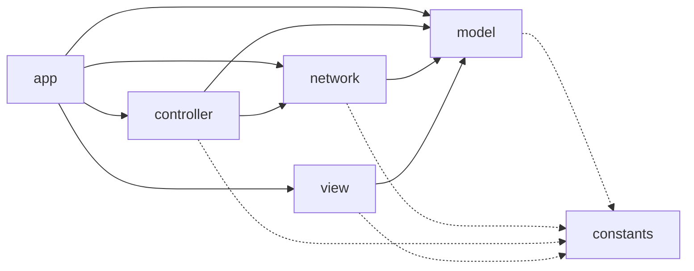
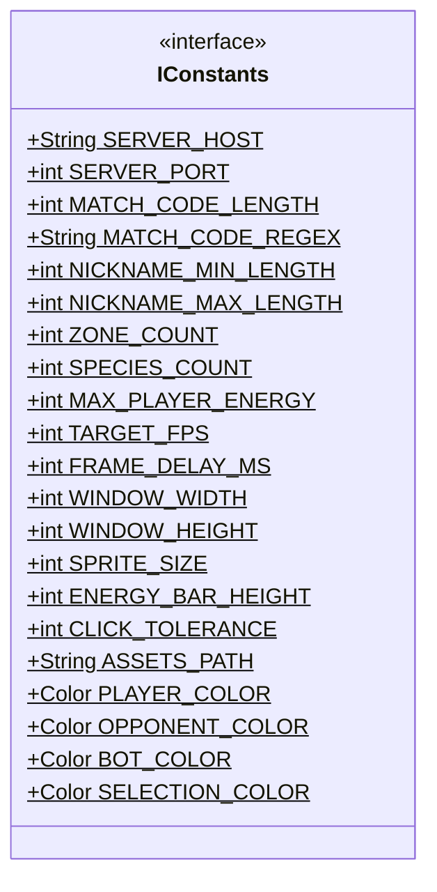
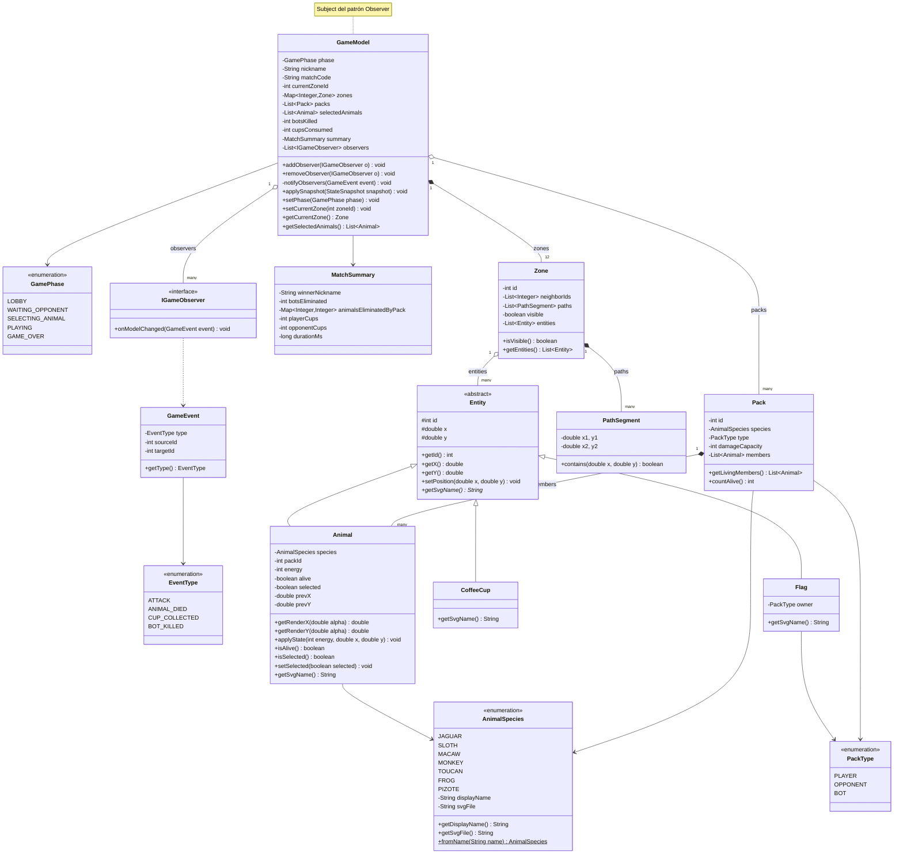
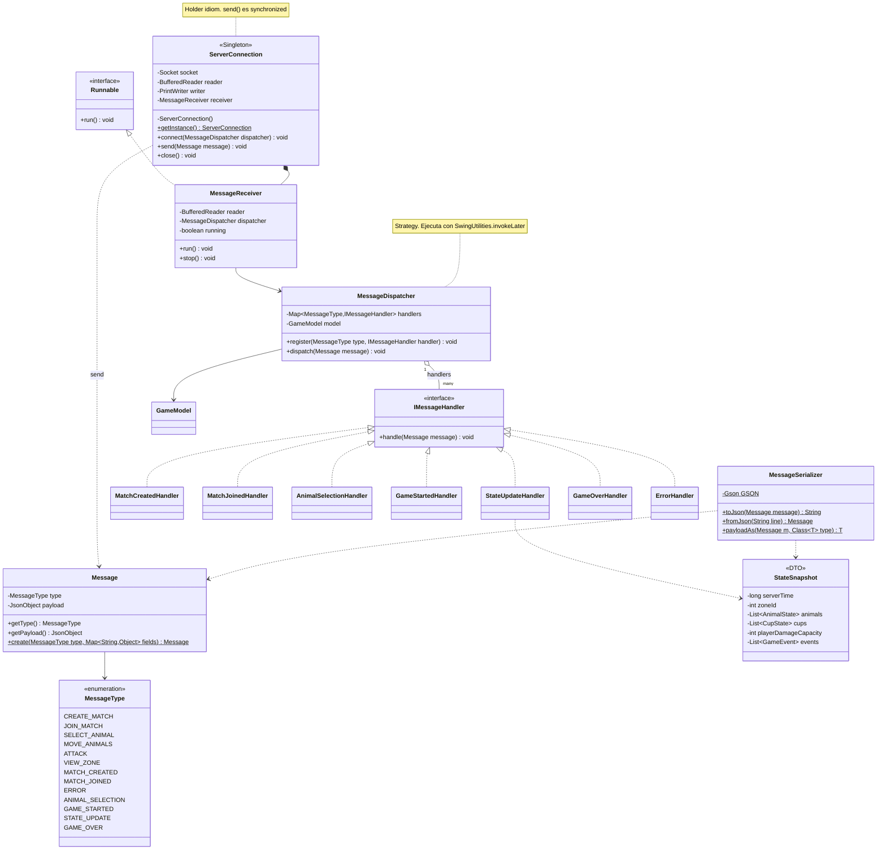
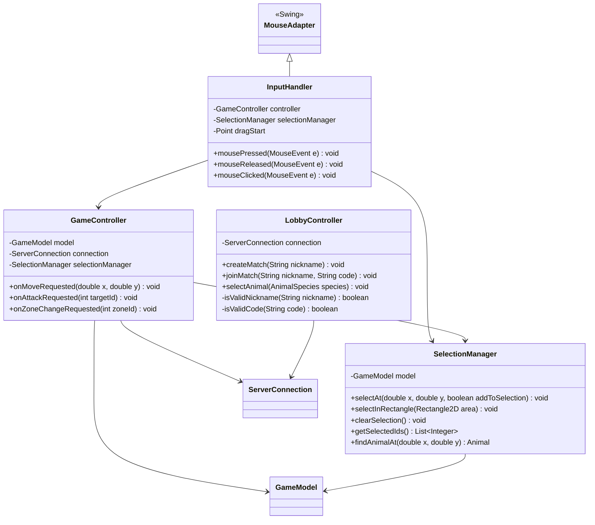
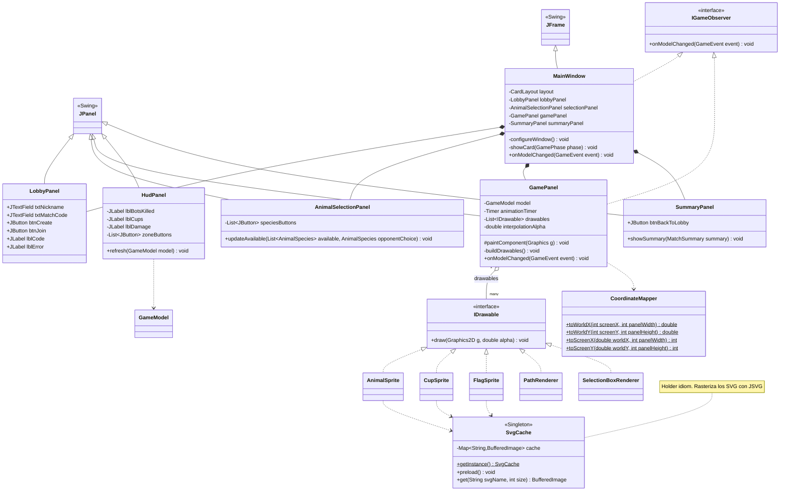
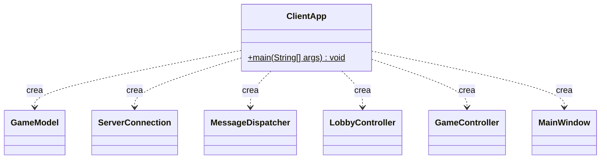

# Jungle Attack - Cliente

## Integrantes

- Andy Quiros Salazar
- Jordan Seas Alvarez

## Specs

### Vista general de paquetes



### Package: constants



```java
public interface IConstants

+static final String SERVER_HOST = "localhost" // host del servidor
+static final int SERVER_PORT = por definir // puerto del servidor
+static final int MATCH_CODE_LENGTH = 4 // largo del código de partida
+static final String MATCH_CODE_REGEX = "[A-Za-z0-9]{4}" // validación local del código
+static final int NICKNAME_MIN_LENGTH = por definir // largo mínimo del apodo
+static final int NICKNAME_MAX_LENGTH = por definir // largo máximo del apodo
+static final int ZONE_COUNT = 12 // zonas del mapa
+static final int SPECIES_COUNT = 7 // especies disponibles
+static final int MAX_PLAYER_ENERGY = 20 // energía máxima de un animal del jugador
+static final int TARGET_FPS = 30 // cuadros por segundo del render
+static final int FRAME_DELAY_MS = 1000 / TARGET_FPS // delay del Timer de Swing
+static final int WINDOW_WIDTH // ancho de la ventana
+static final int WINDOW_HEIGHT // alto de la ventana
+static final int SPRITE_SIZE // tamaño de un animal en pantalla
+static final int ENERGY_BAR_HEIGHT // alto de la barra de energía
+static final int CLICK_TOLERANCE // radio en píxeles para detectar un clic sobre un animal
+static final String ASSETS_PATH = "/assets/svg/" // carpeta de los SVG
+static final Color PLAYER_COLOR // color del pack del jugador
+static final Color OPPONENT_COLOR // color del pack del oponente
+static final Color BOT_COLOR // color de los packs bot
+static final Color SELECTION_COLOR // color del resaltado de selección
```

### Package: model

**Clase principal testeable:** `GameModel`



```java
enum AnimalSpecies
JAGUAR, SLOTH, MACAW, MONKEY, TOUCAN, FROG, PIZOTE // las 7 especies nativas de Costa Rica
-String displayName // nombre para mostrar
-String svgFile // nombre del archivo SVG del animal
+String getDisplayName()
+String getSvgFile()
+static AnimalSpecies fromName(String name) // convierte el texto del JSON a la especie

enum PackType
PLAYER, OPPONENT, BOT // quién controla el pack, define el color y las acciones permitidas

enum GamePhase
LOBBY, WAITING_OPPONENT, SELECTING_ANIMAL, PLAYING, GAME_OVER // fase actual del cliente

abstract class Entity
#int id // id asignado por el servidor
#double x // coordenada horizontal en el mapa
#double y // coordenada vertical en el mapa
+int getId()
+double getX()
+double getY()
+void setPosition(double x, double y)
+abstract String getSvgName() // cada entidad dice qué imagen usa (polimorfismo)

class Animal extends Entity
-AnimalSpecies species // especie
-int packId // pack al que pertenece
-int energy // energía actual
-boolean alive // está vivo
-boolean selected // seleccionado por el jugador (solo local)
-double prevX // posición del snapshot anterior (para interpolar)
-double prevY
+double getRenderX(double alpha) // posición interpolada para dibujar
+double getRenderY(double alpha)
+void applyState(int energy, double x, double y) // actualiza con el snapshot nuevo
+boolean isAlive()
+boolean isSelected()
+void setSelected(boolean selected)
+String getSvgName() // sobrescribe: devuelve el SVG de su especie

class CoffeeCup extends Entity
+String getSvgName() // sobrescribe: devuelve el SVG de la taza de café

class Flag extends Entity
-PackType owner // de quién es la bandera
+String getSvgName() // sobrescribe: devuelve el SVG de la bandera

class Pack
-int id // id del pack
-AnimalSpecies species // especie del pack
-PackType type // PLAYER, OPPONENT o BOT
-int damageCapacity // daño compartido por todos los miembros
-List<Animal> members // animales del pack
+List<Animal> getLivingMembers() // solo los vivos
+int countAlive()

class Zone
-int id // 0 a 11
-List<Integer> neighborIds // zonas conectadas por camino
-List<PathSegment> paths // caminos transitables dentro de la zona
-boolean visible // true si el jugador tiene un animal vivo ahí
-List<Entity> entities // lo visible en la zona (animales, tazas, bandera)
+boolean isVisible()
+List<Entity> getEntities()

class PathSegment
-double x1, y1 // punto inicial
-double x2, y2 // punto final
+boolean contains(double x, double y) // si un punto cae sobre el camino (valida clics de destino)

class MatchSummary
-String winnerNickname // ganador
-int botsEliminated // bots eliminados
-Map<Integer, Integer> animalsEliminatedByPack // bajas por pack
-int playerCups // tazas consumidas por el jugador
-int opponentCups // tazas consumidas por el oponente
-long durationMs // duración del match

class GameEvent
-EventType type // ATTACK, ANIMAL_DIED, CUP_COLLECTED, BOT_KILLED
-int sourceId // quién genera el evento
-int targetId // a quién afecta
+EventType getType() // sirve para disparar animaciones y sonidos

interface IGameObserver
+void onModelChanged(GameEvent event) // se llama cada vez que el sujeto notifica un cambio

class GameModel  (Subject del Observer)
-GamePhase phase // fase actual
-String nickname // apodo del jugador
-String matchCode // código de la partida
-int currentZoneId // zona que se está viendo
-Map<Integer, Zone> zones // las 12 zonas
-List<Pack> packs // packs conocidos
-List<Animal> selectedAnimals // selección actual del jugador
-int botsKilled // contador de bots eliminados
-int cupsConsumed // tazas consumidas
-MatchSummary summary // resumen al terminar
-List<IGameObserver> observers // vistas suscritas
+void addObserver(IGameObserver o)
+void removeObserver(IGameObserver o)
-void notifyObservers(GameEvent event) // avisa a todas las vistas
+void applySnapshot(StateSnapshot snapshot) // actualiza el modelo con un STATE_UPDATE
+void setPhase(GamePhase phase)
+void setCurrentZone(int zoneId) // solo permite zonas donde hay animales vivos
+Zone getCurrentZone()
+List<Animal> getSelectedAnimals()
```

### Package: network

**Clase principal testeable:** `MessageSerializer`



```java
enum MessageType
CREATE_MATCH, JOIN_MATCH, SELECT_ANIMAL, MOVE_ANIMALS, ATTACK, VIEW_ZONE // cliente  -> servidor
MATCH_CREATED, MATCH_JOINED, ERROR, ANIMAL_SELECTION, GAME_STARTED, STATE_UPDATE, GAME_OVER // servidor -> cliente

class Message
-MessageType type // tipo del mensaje
-JsonObject payload // contenido
+MessageType getType()
+JsonObject getPayload()
+static Message create(MessageType type, Map<String, Object> fields) // arma un mensaje a partir de un tipo y sus campos

class MessageSerializer
-static final Gson GSON // instancia única de Gson
+static String toJson(Message message) // objeto → una línea JSON
+static Message fromJson(String line) // una línea JSON → objeto
+static <T> T payloadAs(Message m, Class<T> type) // convierte el payload a un DTO

class StateSnapshot  (DTO del STATE_UPDATE)
-long serverTime // marca de tiempo del servidor
-int zoneId // zona a la que corresponde
-List<AnimalState> animals // posición, energía y vida de cada animal visible
-List<CupState> cups // tazas visibles
-int playerDamageCapacity // daño actual del pack del jugador
-List<GameEvent> events // eventos desde el snapshot anterior

class ServerConnection  (Singleton, holder idiom)
-static class Holder // clase interna que guarda INSTANCE
-Socket socket
-BufferedReader reader // UTF-8
-PrintWriter writer // UTF-8
-MessageReceiver receiver // hilo lector
-ServerConnection() // constructor privado
+static ServerConnection getInstance()
+void connect(MessageDispatcher dispatcher) // abre el socket e inicia el hilo lector
+synchronized void send(Message message) // envía un mensaje (sincronizado, lo llaman varios controladores)
+void close() // cierra socket y flujos en finally

class MessageReceiver implements Runnable
-BufferedReader reader
-MessageDispatcher dispatcher
-volatile boolean running
+void run() // lee línea por línea y delega al dispatcher
+void stop()

interface IMessageHandler
+void handle(Message message) // cada tipo de mensaje del servidor tiene su manejador

class MessageDispatcher
-Map<MessageType, IMessageHandler> handlers // tipo → manejador (Strategy)
-GameModel model
+void register(MessageType type, IMessageHandler handler)
+void dispatch(Message message) // busca el manejador y lo ejecuta con SwingUtilities.invokeLater

// Manejadores (todos implements IMessageHandler)
class MatchCreatedHandler // guarda el código y pasa a WAITING_OPPONENT
class MatchJoinedHandler // pasa a SELECTING_ANIMAL
class AnimalSelectionHandler // actualiza especies disponibles y la elección del oponente
class GameStartedHandler // carga mapa, zona propia y pack inicial; pasa a PLAYING
class StateUpdateHandler // llama a model.applySnapshot(...)
class GameOverHandler // guarda el MatchSummary y pasa a GAME_OVER
class ErrorHandler // código inválido, partida llena, especie ya tomada: notifica a la vista
```

### Package: controller

**Clase principal testeable:** `SelectionManager`



```java
class SelectionManager
-GameModel model
+void selectAt(double x, double y, boolean addToSelection) // clic simple sobre un animal propio
+void selectInRectangle(Rectangle2D area) // selección por arrastre
+void clearSelection()
+List<Integer> getSelectedIds()
+Animal findAnimalAt(double x, double y) // usa CLICK_TOLERANCE

class GameController
-GameModel model
-ServerConnection connection
-SelectionManager selectionManager
+void onMoveRequested(double x, double y) // valida que el destino esté sobre un camino y envía MOVE_ANIMALS
+void onAttackRequested(int targetId) // envía ATTACK solo si el objetivo no es del propio jugador
+void onZoneChangeRequested(int zoneId) // envía VIEW_ZONE

class LobbyController
-ServerConnection connection
+void createMatch(String nickname) // valida el apodo y envía CREATE_MATCH
+void joinMatch(String nickname, String code) // valida el código con MATCH_CODE_REGEX y envía JOIN_MATCH
+void selectAnimal(AnimalSpecies species) // envía SELECT_ANIMAL
-boolean isValidNickname(String nickname)
-boolean isValidCode(String code)

class InputHandler extends MouseAdapter
-GameController controller
-SelectionManager selectionManager
-Point dragStart // inicio de la selección por arrastre
+void mousePressed(MouseEvent e) // clic izquierdo: inicia selección
+void mouseReleased(MouseEvent e) // clic izquierdo: termina el rectángulo de selección
+void mouseClicked(MouseEvent e) // clic derecho en camino: mover; clic derecho sobre enemigo/bot: atacar
```

### Package: view

**Clase principal testeable:** `CoordinateMapper`



```java
class CoordinateMapper
+static double toWorldX(int screenX, int panelWidth) // pantalla → coordenadas del mapa
+static double toWorldY(int screenY, int panelHeight)
+static int toScreenX(double worldX, int panelWidth) // mapa → pantalla
+static int toScreenY(double worldY, int panelHeight)

class SvgCache  (Singleton)
-static class Holder // holder idiom: la JVM crea la instancia una sola vez y de forma segura entre hilos
-Map<String, BufferedImage> cache // imágenes ya rasterizadas
+static SvgCache getInstance()
+void preload() // rasteriza todos los SVG una sola vez al arrancar (JSVG)
+BufferedImage get(String svgName, int size) // devuelve la imagen del caché

interface IDrawable
+void draw(Graphics2D g, double alpha) // cada elemento sabe dibujarse (polimorfismo)

// Dibujables (todos implements IDrawable)
class AnimalSprite // imagen SVG +barra de energía +resaltado si está seleccionado +color del pack
class CupSprite // taza de café sobre el camino
class FlagSprite // bandera con el color de su dueño
class PathRenderer // dibuja los caminos de la zona
class SelectionBoxRenderer // rectángulo de arrastre

class MainWindow extends JFrame implements IGameObserver
-CardLayout layout // alterna entre pantallas
-LobbyPanel lobbyPanel
-AnimalSelectionPanel selectionPanel
-GamePanel gamePanel
-SummaryPanel summaryPanel
-void configureWindow() // tamaño, título, cierre
-void showCard(GamePhase phase) // muestra la pantalla según la fase
+void onModelChanged(GameEvent event) // cambia de pantalla o repinta

class LobbyPanel extends JPanel
+JTextField txtNickname // apodo
+JTextField txtMatchCode // código de 4 caracteres
+JButton btnCreate // crear partida
+JButton btnJoin // unirse a partida
+JLabel lblCode // muestra el código generado mientras espera al oponente
+JLabel lblError // errores del servidor

class AnimalSelectionPanel extends JPanel
-List<JButton> speciesButtons // un botón con imagen por especie
+void updateAvailable(List<AnimalSpecies> available, AnimalSpecies opponentChoice) // deshabilita la especie ya tomada

class GamePanel extends JPanel implements IGameObserver
-GameModel model
-javax.swing.Timer animationTimer // repinta a TARGET_FPS
-List<IDrawable> drawables // lo que se dibuja en el cuadro actual
-double interpolationAlpha // avance entre el snapshot anterior y el actual
#void paintComponent(Graphics g) // pinta fondo, caminos, cups, bandera, animales, selección
-void buildDrawables() // arma la lista a partir de la zona actual del modelo
+void onModelChanged(GameEvent event) // dispara animación según el evento

class HudPanel extends JPanel
-JLabel lblBotsKilled // bots eliminados
-JLabel lblCups // tazas consumidas
-JLabel lblDamage // capacidad de daño del pack
-List<JButton> zoneButtons // cambiar entre zonas donde hay animales vivos
+void refresh(GameModel model)

class SummaryPanel extends JPanel
+void showSummary(MatchSummary summary) // bots eliminados, bajas por pack, tazas por jugador y duración
+JButton btnBackToLobby
```

### Package: app



```java
class ClientApp
+static void main(String[] args) // crea el modelo, la conexión, los controladores y la ventana; conecta todo
```
